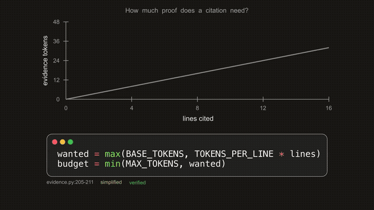

# ManimSimpleRender

**Explainer Engine**: turns a short storyboard YAML that cites real source lines into a narrated,
animated Manim video, and refuses to render if a citation no longer matches the code.

Before anything is rendered, a citation gate checks that the cited source lines still contain the
evidence the storyboard declares for them (as whole words, with some on the first and the last
cited line), and stops the render if any do not. The gate checks citations, not narration.



*A clip from `examples/evidence-budget.story.yaml`, rendered by the Explainer Engine.*

## Examples

Full videos and write-up: <https://www.frankxue.dev/projects/explainer-engine/>.

- **Evidence budget** ([video](https://www.frankxue.dev/projects/explainer-engine/#budget-video)):
  storyboard [`examples/evidence-budget.story.yaml`](examples/evidence-budget.story.yaml), which
  cites this repo's own `explainer/plan/evidence.py`.
- **Citation gate** ([video](https://www.frankxue.dev/projects/explainer-engine/#gate-video)):
  storyboard [`examples/citation-gate.story.yaml`](examples/citation-gate.story.yaml), which
  explains the gate itself by citing `explainer/cite/verifier.py`.
- **Harness-Field** ([video](https://www.frankxue.dev/projects/explainer-engine/#harness-video)):
  its storyboard is not public and is not in this repository.

## Quick start

Check a storyboard's citations (light install: PyYAML only, no manim, no system libraries):

```bash
git clone https://github.com/frankxue831/ManimSimpleRender.git
cd ManimSimpleRender
python3.12 -m venv .venv && source .venv/bin/activate   # Python 3.12 or 3.13
pip install -e ".[verify]"
explainer verify examples/evidence-budget.story.yaml
```

`verify` runs the citation gate, then checks that the code generator accepts the storyboard; it
only reads files, does not render or call TTS, and needs no network.

To render video, first install Manim's system prerequisites (cairo/pango headers, ffmpeg, and
LaTeX), which `pip` does not install. Without the cairo headers, `pip install` fails while
building `pycairo`.

```bash
# Debian/Ubuntu
sudo apt-get install -y build-essential pkg-config python3-dev libcairo2-dev libpango1.0-dev ffmpeg texlive texlive-latex-extra
# macOS (Homebrew)
brew install pkg-config cairo pango ffmpeg
brew install --cask mactex-no-gui
```

Then, in the same venv:

```bash
pip install -e ".[explainer]"
explainer render examples/evidence-budget.story.yaml -o out.mp4
```

See the [Manim installation guide](https://docs.manim.community/en/stable/installation.html) for
other platforms. `render` also needs **network access for narration.** The only supported voice
is `gtts` (manim-voiceover's Google Text-to-Speech service, a live Google endpoint). No API key or
credential is needed, and there is no offline TTS fallback: synthesis is retried with backoff,
then the render fails. Audio is cached by narration text, one folder per language, under
`~/.cache/explainer/voiceovers` (override with `EXPLAINER_TTS_CACHE`), so a re-render of
unchanged narration reuses the cache.

## Explainer and concept-render tools

These are separate command-line tools in the same repo. Any step that renders video needs the
Manim system prerequisites listed in the [Quick start](#quick-start).

### Explainer (`explainer/`)

The `explainer` command (equivalent: `python -m explainer.cli`) has `verify` and `render` (see
[Quick start](#quick-start); `render` takes `--quality ql|qm|qh|qp|qk|1080p`) and `plan`, which
drafts a storyboard from real code with an LLM. It shares the Qt-free render core with the GUI;
see `docs/adr/0001-render-core-boundary.md` for that boundary.

```bash
explainer plan --repo . --focus PATH[:START-END] --topic "what to explain" -o draft.story.yaml \
  [--provider grok|anthropic] [--beats 4] [--revisions 1] [--dry-run]
```

`--focus` is repeatable. `--dry-run` prints the prompt and exits without calling a model.
Run `explainer plan --help` for the remaining options (`--model`, `--effort`, `--max-tokens`,
`--max-repairs`, `--allow-dirty`).

Planner providers and environment variables:

- `--provider grok` (the default) runs the `grok` CLI as a subprocess. It must be on `PATH`,
  or set `EXPLAINER_GROK_BIN` to the binary's path.
- `--provider anthropic` needs `pip install -e ".[planner]"` and an Anthropic API key, read by
  the SDK from `ANTHROPIC_API_KEY` (or an `ant` profile).
- `EXPLAINER_TTS_CACHE` (optional) sets the narration cache directory used by `render`.

### Concept render (`concept_render/`)

Renders a silent concept draft from a JSON input (max 64 KiB) and prints a JSON receipt.
Run it from a source checkout; it needs no API key. See `docs/concept-render.md` for the
input format.

```bash
python -m concept_render --input examples/concepts/team_growth.json --output-dir output/concepts --timeout 60
python -m concept_render.revision --original original.json --candidate candidate.json
```

`--timeout` is in seconds, defaults to 60, and must be greater than 0 and at most 120.

## Also in this repo: desktop GUI

A PyQt5 desktop GUI for discovering and batch-rendering [Manim](https://www.manim.community/)
scenes. Point it at a folder of Manim scripts, pick the scenes you want, choose a resolution
and engine, and it renders them via the `manim` CLI in a background thread with live logs and
per-scene results.

### Features

- **Automatic scene discovery** — AST-based, import-free scanning of a folder's `*.py` files;
  no need to list scene classes by hand (see `app/scenes/discovery.py`).
- **Batch rendering** off the UI thread, with a progress bar, streaming log, cancellation, and
  per-scene pass/fail decoration.
- **Resolution + engine selection** (`-ql`/`-qm`/`-qh`/`-qk`; cairo or OpenGL).
- Remembers your last folders, resolution, and engine (via `QSettings`).
- Dark theme.

### Requirements

- **Python 3.12 or 3.13** (both install numpy 2.x)
- **Manim 0.20.1** and its **system prerequisites**, which `pip` does *not* install:
  **ffmpeg**, a **LaTeX** distribution, and **cairo/pango** (see the apt/brew lines in the
  [Quick start](#quick-start)).

> Tip: click **Check Environment** in the app to verify that manim, ffmpeg, and LaTeX are
> detected in the interpreter that will run the render, before you start a batch.

### Installation

```bash
# Create and activate a virtual environment
python -m venv .venv
source .venv/bin/activate           # Windows: .venv\Scripts\activate

# Install the GUI + manim (same as: pip install -e ".[gui]")
pip install -r requirements.txt
```

Alternatively, install the package itself to get the `manim-simple-render` launch command:

```bash
pip install ".[gui]"
```

### Usage

```bash
python main.py            # from a source checkout
# or, if installed as a package:
manim-simple-render
```

Then in the window:

1. Choose an **input folder** containing your Manim `.py` scripts (scenes are discovered
   automatically) and an **output folder** (created if it doesn't exist).
2. Select one or more **scenes**, a **resolution**, and a **render engine**.
3. Click **Start Render**. Progress, logs, and per-scene results appear live; **Cancel** stops
   an in-flight batch.

> Note: rendering executes the selected Python files via Manim. Only point the app at scripts
> you trust.

> Engine tip: prefer the **Default** (cairo) engine. The **OpenGL** engine uses a different
> object model and is not reliable for every scene/platform (e.g. some scenes that render fine
> under cairo raise errors under OpenGL on macOS). If a render fails only under OpenGL, switch
> back to Default — a failed render is shown red per-scene with the error in the log.

### Standalone app (advanced)

You can package the **GUI** as a clickable desktop app with
[PyInstaller](https://pyinstaller.org/) so end users don't need a Python environment.
By design this bundles the GUI only — the render toolchain (**manim, ffmpeg, LaTeX**)
stays **external** and must be installed and on `PATH` (use **Check Environment** in the
app to confirm). The app detects the frozen build and invokes the external `manim`
instead of `python -m manim` automatically.

```bash
pip install pyinstaller
pyinstaller --noconfirm --windowed --name ManimSimpleRender \
  --add-data "app/config/config.v2.json:app/config" \
  --add-data "app/ui/theme.qss:app/ui" \
  main.py
# On Windows, use ';' instead of ':' in --add-data.
```

The bundle appears under `dist/`. This is a per-OS maintainer/release step (build and
test on each target platform); the packaged data files (`config.v2.json`, `theme.qss`)
resolve inside the bundle automatically. It is intentionally not produced by CI.

## Development

```bash
pip install -r requirements-dev.txt          # adds black + flake8
QT_QPA_PLATFORM=offscreen python -m unittest discover -s tests   # run the test suite headless
black --check app explainer tests main.py    # formatting (same as CI)
flake8 app explainer tests main.py           # linting (same as CI)
```

CI (GitHub Actions) runs the same checks on every push and pull request. The architecture is
layered — UI → controller → services (config, scenes, environment, render, validation); services
are Qt-free and unit-tested headless. See `AGENTS.md` for the architecture overview.

## License

[Apache License 2.0](LICENSE).
